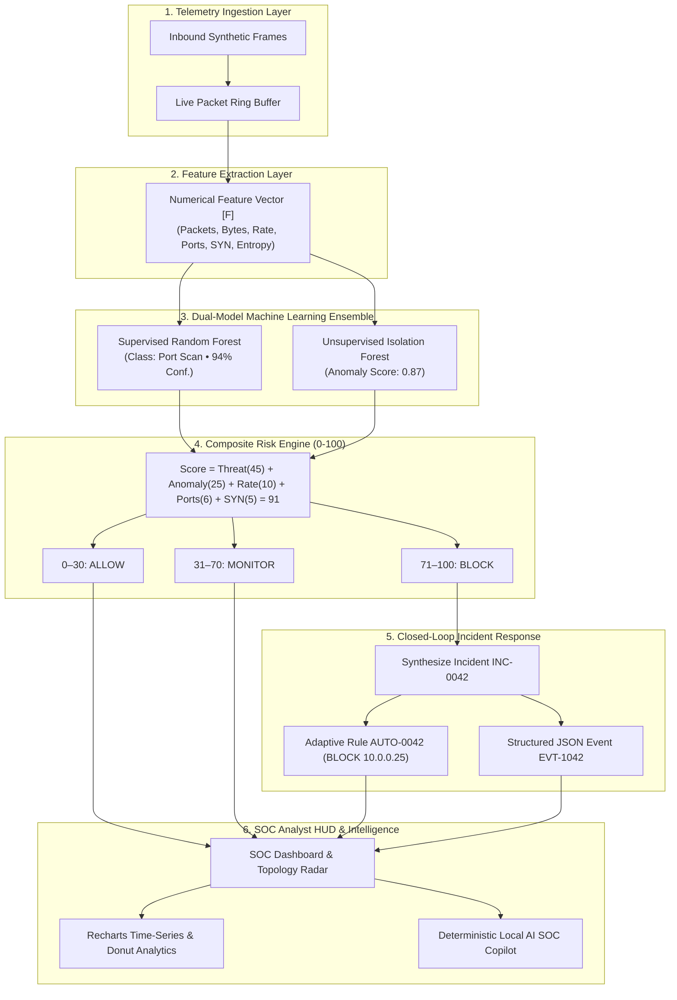

# 🛡️ SentinelAI — System Architecture & Module Technical Guide
### AI-Powered Network Intrusion Detection & Automated Incident Response
*(Adaptive AI Firewall with SIEM-Based Threat Intelligence)*

> **DEMO MODE • SIMULATED SECURITY TELEMETRY**  
> *SentinelAI is a premier frontend-only cybersecurity Security Operations Center (SOC) demonstration. Network telemetry, machine learning classifications, composite risk scores, automated firewall responses, and SIEM logs are generated and processed entirely within the local browser sandbox.*

---

## 📑 Table of Contents
1. [Executive Summary & Core Security Lifecycle](#1-executive-summary--core-security-lifecycle)
2. [End-to-End System Architecture Pipeline](#2-end-to-end-system-architecture-pipeline)
3. [Simulated Feature Vector Extraction Engine](#3-simulated-feature-vector-extraction-engine)
4. [Dual-Model Machine Learning Inference](#4-dual-model-machine-learning-inference)
5. [Composite Risk Engine Mathematical Model](#5-composite-risk-engine-mathematical-model)
6. [Detailed Module & Route Breakdown](#6-detailed-module--route-breakdown)
   - [A. SOC Command Center Dashboard (`/`)](#a-soc-command-center-dashboard-)
   - [B. Live Network Traffic & DPI Flow Inspector (`/traffic`)](#b-live-network-traffic--dpi-flow-inspector-traffic)
   - [C. AI Threat Detection Engine (`/threats`)](#c-ai-threat-detection-engine-threats)
   - [D. 7-Stage Incident Response Lifecycle (`/incidents`)](#d-7-stage-incident-response-lifecycle-incidents)
   - [E. Adaptive AI Firewall Simulation (`/firewall`)](#e-adaptive-ai-firewall-simulation-firewall)
   - [F. Enterprise SIEM Forensic Explorer (`/siem`)](#f-enterprise-siem-forensic-explorer-siem)
   - [G. URL & Phishing Security Analyzer (`/url-security`)](#g-url--phishing-security-analyzer-url-security)
   - [H. SOC Analytics & Telemetry Metrics (`/analytics`)](#h-soc-analytics--telemetry-metrics-analytics)
   - [I. Cyber Attack Simulation Lab (`/simulator`)](#i-cyber-attack-simulation-lab-simulator)
   - [J. Global AI SOC Copilot Drawer (`✦ AI COPILOT`)](#j-global-ai-soc-copilot-drawer--ai-copilot)
7. [Global State Management & Reactive Synchronization](#7-global-state-management--reactive-synchronization)
8. [Judge & Stakeholder Presentation Script (10-Step Walkthrough)](#8-judge--stakeholder-presentation-script-10-step-walkthrough)
9. [Safety & Ethics Statement](#9-safety--ethics-statement)

---

## 1. Executive Summary & Core Security Lifecycle

Modern cyber adversaries employ automated scanning tools, polymorphic payloads, and distributed credential attacks that bypass traditional static rule-based firewalls. Security operations teams often suffer from alert fatigue because conventional firewalls generate excessive unprioritized alerts without automated risk scoring or closed-loop containment.

**SentinelAI** bridges this gap by demonstrating an autonomous, AI-driven cybersecurity lifecycle:

```text
🌐 SIMULATED NETWORK TRAFFIC (10.0.0.x / 10.0.0.10)
            ↓
📡 TRAFFIC TELEMETRY (Packets, Bytes, Connection Rate)
            ↓
🔍 FEATURE EXTRACTION [842, 120420, 92, 38, 720, 0.82]
            ↓
🤖 AI THREAT DETECTION (Random Forest 94% + Isolation Forest 0.87)
            ↓
🎯 RISK ENGINE (Composite Score: 91 / 100 — CRITICAL)
            ↓
🚨 INCIDENT CLASSIFICATION (INC-0042 Lifecycle Tracking)
            ↓
🛡️ ADAPTIVE RESPONSE (AUTO-0042 BLOCK Simulated Rule)
            ↓
📋 SIEM EVENT (EVT-1042 Structured Forensic JSON)
            ↓
🖥️ SOC DASHBOARD (Dynamic KPIs, Topology Radar & Analytics)
            ↓
👨‍💻 SECURITY ANALYST & AI SOC COPILOT
```

---

## 2. End-to-End System Architecture Pipeline



---

## 3. Simulated Feature Vector Extraction Engine

When network flows traverse SentinelAI, the telemetry layer extracts a standardized 6-dimensional numerical vector $\vec{F}$:

$$\vec{F} = [ P, B, R, U, S, E ]$$

Where:
* **$P$ (Packet Count)**: Total number of packets transferred during the flow inspection window.
* **$B$ (Byte Count)**: Total volume of bytes transferred (payload + protocol headers).
* **$R$ (Connection Rate)**: Connection requests initiated per second ($\text{conn/s}$).
* **$U$ (Unique Destination Ports)**: Count of unique TCP/UDP destination ports probed by the source IP.
* **$S$ (SYN Packet Density)**: Total TCP packets with the `SYN` flag asserted without completing handshakes.
* **$E$ (Shannon Entropy Ratio)**: Measure of randomness across packet payload and destination distribution ($0.00$ to $1.00$).

### Benchmark Flow Vectors:

| Scenario | $\vec{F}$ Vector | Behavior Profile |
|---|---|---|
| **Normal HTTPS** | `[ 48, 64200, 4, 1, 2, 0.24 ]` | Low connection rate, single port (443), low SYN count. |
| **Port Scan** | `[ 842, 120420, 92, 38, 720, 0.82 ]` | High velocity, 38 ports probed, 720 SYN packets. |
| **SSH Brute Force** | `[ 1420, 98400, 140, 1, 140, 0.45 ]` | Port 22 repeated connection bursts. |
| **DoS SYN Flood** | `[ 8940, 572000, 850, 2, 8800, 0.94 ]` | Massive packet count and connection saturation. |

---

## 4. Dual-Model Machine Learning Inference

SentinelAI simulates a multi-tier machine learning defense ensemble:

### 1. Supervised Random Forest Classifier (100 Trees)
* **Function**: Multi-class supervised decision tree ensemble trained on network intrusion datasets (such as CIC-IDS2017 / NSL-KDD patterns).
* **Outputs**: Predicted threat category (`PORT SCAN`, `BRUTE FORCE`, `DOS FLOOD`, `NETWORK ANOMALY`, `SUSPICIOUS CONNECTION`) with statistical confidence percentages (e.g. $94\%$).

### 2. Unsupervised Isolation Forest (Contamination = 0.05)
* **Function**: Path-depth outlier detection algorithm designed to isolate zero-day anomalies without requiring prior labeled signatures.
* **Outputs**: Continuous anomaly score between $0.00$ and $1.00$. Scores above $0.80$ trigger anomalous behavioral alerts.

---

## 5. Composite Risk Engine Mathematical Model

Rather than relying purely on binary blacklists, SentinelAI computes an explainable Composite Risk Score $R \in [0, 100]$:

$$R = \min\left(100, W_{\text{threat}} + W_{\text{anomaly}} + W_{\text{rate}} + W_{\text{ports}} + W_{\text{syn}}\right)$$

### Factor Weight Distribution:
1. **Threat Classification Weight ($W_{\text{threat}}$)**: $+45$ points if the Random Forest classifier matches a high-severity attack profile.
2. **Anomaly Score Contribution ($W_{\text{anomaly}}$)**: $+25$ points if Isolation Forest path depth anomaly score $> 0.80$.
3. **Connection Rate Factor ($W_{\text{rate}}$)**: $+10$ points if connection rate $> 80\text{ conn/s}$.
4. **Port Dispersion Spread ($W_{\text{ports}}$)**: $+6$ points if unique destination ports $> 25$.
5. **SYN Flag Burst Factor ($W_{\text{syn}}$)**: $+5$ points if unacknowledged SYN packets $> 500$.

$$\text{Example Risk Score} = 45 + 25 + 10 + 6 + 5 = 91 / 100 \rightarrow \mathbf{CRITICAL}$$

### 3-Tier Policy Action Matrix:
* 🟢 **0–30 (LOW RISK)**: **ALLOW** — Normal traffic is permitted without latency.
* 🟡 **31–70 (MEDIUM RISK)**: **MONITOR** — Connection is flagged for DPI behavioral tracking.
* 🔴 **71–100 (HIGH / CRITICAL RISK)**: **BLOCK** — Instant simulated firewall quarantine rule (`AUTO-0042`) is synthesized.

---

## 6. Detailed Module & Route Breakdown

### A. SOC Command Center Dashboard (`/`)
* **Purpose**: Primary overview HUD for SOC Tier 1/2 analysts.
* **Key Components**:
  * **7 KPI Cards**: Total Events, Threats Detected, Active Incidents, High Risk Events, Blocked Sources, Monitored Connections, Average Risk Score.
  * **Interactive Quick Simulator Banner**: One-click attack launch bar for judge presentations.
  * **Topology Radar**: Real-time status display of protected subnet assets (`10.0.0.10` Web Gateway, `10.0.0.15` DB Cluster, `10.0.0.42` Auth Vault).
  * **DEFCON 1 Emergency Containment**: Instant red-alert lockdown dropping all ingress socket connections.
  * **Live SIEM Feed**: Real-time ticker of ingested security audit events.

### B. Live Network Traffic & DPI Flow Inspector (`/traffic`)
* **Purpose**: Simulates deep packet inspection (DPI) flow logs and bandwidth metrics.
* **Key Components**:
  * Ingress vs Egress bandwidth area charts and socket distribution bar charts.
  * Tabular stream showing `Timestamp`, `Source IP`, `Destination`, `Port`, `Protocol`, `Packets`, `Bytes`, and `Status`.
  * **Network Flow Feature Inspector Modal**: Clicking any packet displays the exact feature vector $\vec{F} = [842, 120420, 92, 38, 720, 0.82]$ and technical explanation.

### C. AI Threat Detection Engine (`/threats`)
* **Purpose**: Visualizes dual-model ML inference and feature attribution.
* **Key Components**:
  * Supervised **Random Forest** classification status with F1 confidence scores.
  * Unsupervised **Isolation Forest** anomaly path depth metrics.
  * Live feature vector breakdown and factor contribution scoring table.
  * Comprehensive threats table with search and severity filters.

### D. 7-Stage Incident Response Lifecycle (`/incidents`)
* **Purpose**: End-to-end incident management, containment, and resolution tracking.
* **7-Stage Progression**:
  1. `DETECTED`: Initial packet anomaly flagged.
  2. `ANALYZING`: Feature vector parsed by AI engine.
  3. `HIGH RISK`: Composite risk score exceeds threshold ($> 70$).
  4. `CONTAINMENT`: Autonomous mitigation triggered.
  5. `BLOCK SIMULATED`: Adaptive firewall policy synthesized (`AUTO-0042`).
  6. `SIEM LOGGED`: Forensic audit record indexed (`EVT-1042`).
  7. `RESOLVED`: Operator triage completed.
* **Interactive Modal**: Allows analysts to quarantine source IPs, mark incidents resolved, or adjust severity levels.

### E. Adaptive AI Firewall Simulation (`/firewall`)
* **Purpose**: Demonstrates autonomous closed-loop policy generation without touching kernel iptables.
* **Key Components**:
  * Synthesized `AUTO-XXXX` rules triggered by high-risk scores.
  * Manual rule creation modal for SOC operators.
  * Rule enable/disable toggles and deletion controls.
  * Prominent demonstration disclaimer confirming zero OS firewall modifications.

### F. Enterprise SIEM Forensic Explorer (`/siem`)
* **Purpose**: Centralized log compliance and forensic correlation search engine.
* **Key Components**:
  * Multi-field search across IP, Event ID, threat name, severity, or action.
  * Filter matrix (`All`, `Critical`, `High`, `Medium`, `Low`, `Blocked`, `Monitored`, `Allowed`).
  * **Structured JSON Forensic Modal**: Inspects raw JSON event payloads matching enterprise Syslog/CEF standards.

### G. URL & Phishing Security Analyzer (`/url-security`)
* **Purpose**: Heuristic client-side inspection of suspicious web links and credential harvesters.
* **10 Heuristic Indicators**:
  1. HTTPS protocol presence.
  2. Raw IP address hostname usage.
  3. Excessive subdomain depth ($\ge 3$).
  4. Abnormally long domain string length.
  5. Sensitive phishing keywords (`login`, `verify`, `account`, `token`, `bank`, `update`).
  6. Brand impersonation detection (`PayPal`, `Microsoft`, `Google`, `Apple`, etc.).
  7. High-risk TLD extensions (`.xyz`, `.top`, `.tk`, `.click`, `.zip`).
  8. Special character obfuscation density.
  9. Total URL length.
  10. Shannon Entropy of the domain string.
* **Actionable Output**: Calculates a 0–100 phishing risk index, provides a verdict (`HIGH RISK` / `SUSPICIOUS` / `SAFE`), and provides a button to **Dispatch to SIEM**.

### H. SOC Analytics & Telemetry Metrics (`/analytics`)
* **Purpose**: High-density Recharts data visualizer for executive reporting.
* **Visualizations**:
  1. **Threats Over Time**: Area/Line chart tracking attacks vs normal traffic.
  2. **Threat Category Distribution**: Bar chart comparing Port Scan, Brute Force, DoS, Anomalies.
  3. **Severity Distribution**: Donut chart (Critical, High, Medium, Low).
  4. **Risk Score Distribution**: Tiered bar chart.
  5. **Response Actions**: Split bar chart (ALLOW / MONITOR / BLOCK).
  6. **Top Attacking Source IPs**: Forensic table of repeat offenders.

### I. Cyber Attack Simulation Lab (`/simulator`)
* **Purpose**: Main interactive demonstration sandbox for judges.
* **5 Attack Scenarios**:
  * 🔎 **Port Scan**: Multi-port SYN probing across `10.0.0.10:20-443` (Risk 91).
  * 🔐 **Brute Force**: High-frequency SSH authentication bursts on port 22 (Risk 87).
  * 🌊 **DoS-like Traffic**: Volumetric packet flood (Risk 96).
  * ⚠️ **Network Anomaly**: Irregular payload entropy (Risk 64).
  * 🔗 **Suspicious Connection**: Covert C2 beaconing socket (Risk 48).
* **Animated 10-Step Execution Pipeline**: Sequentially steps from Step 01 to Step 10 before synchronously updating all application modules.

### J. Global AI SOC Copilot Drawer (`✦ AI COPILOT`)
* **Purpose**: Context-aware virtual senior security analyst.
* **Capabilities**:
  * Runs 100% locally with zero external API calls.
  * Evaluates current simulated application state to answer questions such as:
    * *"What are the highest risk threats?"*
    * *"Why was 10.0.0.25 blocked?"*
    * *"Show active incidents."*
    * *"Explain this port scan."*
    * *"What happened in the last 5 minutes?"*

---

## 7. Global State Management & Reactive Synchronization

All components in SentinelAI share a single synchronized state context (`SecurityContext.tsx`):

```text
[Adversary Sim Triggered in /simulator]
                │
                ▼
   runAttackSimulation() (simulationEngine.ts)
                │
    ┌───────────┼────────────────────────────────────────┐
    ▼           ▼                    ▼                   ▼
NetworkEvent  Threat Model        Incident Store      Firewall Store
(/traffic)    (/threats)          (/incidents)        (/firewall)
    │           │                    │                   │
    └───────────┴──────────┬─────────┴───────────────────┘
                           ▼
                      SIEM Event
                       (/siem)
                           │
                           ▼
             Dashboard & Analytics Updates
                  (/ & /analytics)
```

When an attack scenario is simulated:
* KPI counters increment synchronously.
* The new flow appears in `/traffic`.
* The ML classification is indexed in `/threats`.
* An incident is generated in `/incidents`.
* An `AUTO-XXXX` rule is provisioned in `/firewall`.
* A forensic JSON record is written to `/siem`.
* Analytics charts in `/analytics` reflect the new data.

---

## 8. Judge & Stakeholder Presentation Script (10-Step Walkthrough)

| Step | Location | Demonstration Action | What to Explain to Evaluators |
|:---:|:---|:---|:---|
| **01** | **Dashboard** (`/`) | Inspect live SOC command center | *"This is SentinelAI, an AI-powered SOC command center with 7 dynamic live KPIs, topology radar, and real-time event streaming."* |
| **02** | **Simulation Lab** (`/simulator`) | Select **Port Scan** | *"We can safely simulate an adversary launching a multi-port SYN sweep from `10.0.0.25` against `10.0.0.10`."* |
| **03** | **Simulation Lab** | Click **Simulate Port Scan** | *"Observe the live 10-step telemetry pipeline executing sequentially from packet ingestion to dashboard synchronization."* |
| **04** | **AI Threats** (`/threats`) | Inspect dual ML classification | *"Our AI layer extracts feature vector `[842, 120420, 92, 38, 720, 0.82]`. Random Forest identifies a Port Scan with 94% confidence, while Isolation Forest registers an anomaly score of 0.87."* |
| **05** | **AI Threats** | Review Composite Risk | *"The risk engine computes a score of 91/100 (Critical), crossing the threshold for automated defense."* |
| **06** | **Adaptive Firewall** (`/firewall`) | View synthesized rules | *"The adaptive firewall generated rule `AUTO-0042` to instantly quarantine `10.0.0.25` without touching OS iptables."* |
| **07** | **Incidents** (`/incidents`) | Open `INC-0042` details | *"The incident was logged into a 7-stage lifecycle (`DETECTED` ➔ `CONTAINMENT` ➔ `SIEM LOGGED` ➔ `RESOLVED`)."* |
| **08** | **SIEM Explorer** (`/siem`) | Search `10.0.0.25` | *"Event `EVT-1042` was indexed in structured JSON format for compliance audit and forensic drill-down."* |
| **09** | **AI SOC Copilot** | Click *"Why was 10.0.0.25 blocked?"* | *"Our client-side AI Copilot explains the anomalous SYN burst and cites rule `AUTO-0042`."* |
| **10** | **Dashboard** (`/`) | Observe updated metrics | *"All KPIs (Threats +1, Incidents +1, Blocked +1) have updated synchronously across all views."* |

---

## 9. Safety & Ethics Statement

SentinelAI is constructed strictly as a frontend demonstration:
* ❌ **NO** raw socket or promiscuous packet capture.
* ❌ **NO** modification of operating system routing tables or kernel firewall rules.
* ❌ **NO** transmission of malicious payloads or live port scans across physical networks.
* ❌ **NO** external cloud dependencies or third-party tracking APIs.
* ✅ **100% Safe, client-side educational simulation and hackathon prototype.**

---
*Document Version: 2.5 • SentinelAI Technical Documentation Suite*
